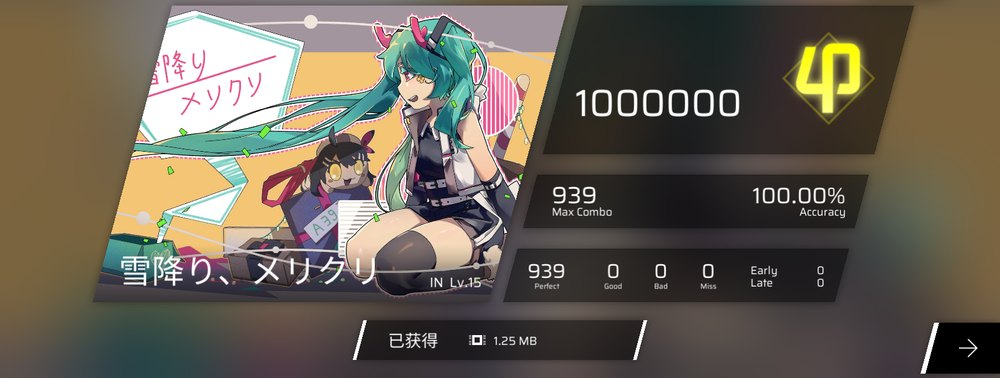
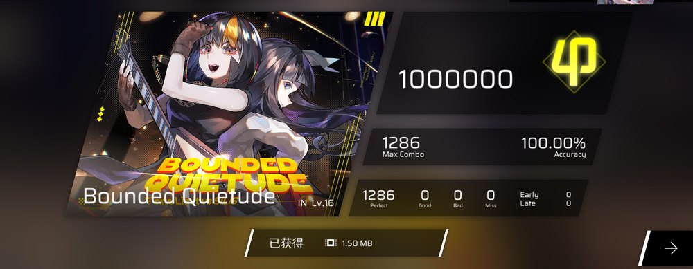
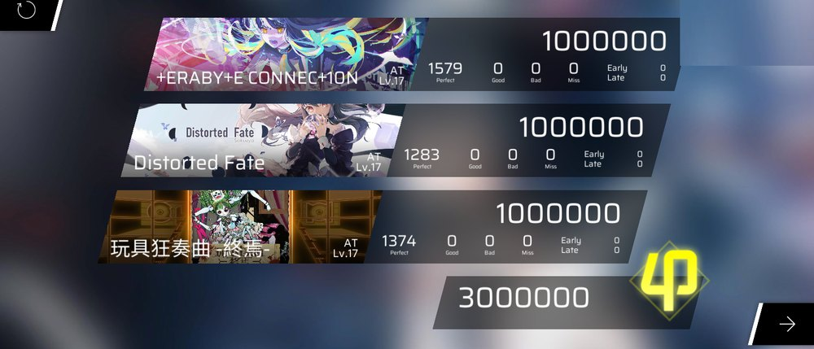

# phigros-auto

在未 root 的安卓手机上离线自动演奏《Phigros》，目标是 φ（1,000,000 / 全 Perfect）。

整个闭环都在手机里：App 替你点 ▶ → 读系统播放流听出曲首起音 → 算出「音乐零点」→
通过 Shizuku 注入触摸 → 你只看结算。电脑只在生成素材和构建 APK 时用，打歌时完全不需要。


## 目录

- [它能干什么](#它能干什么)
- [成果展示](#成果展示)
- [如何使用](#如何使用)
  - [准备](#准备)
  - [运行](#运行)
- [已知限制（不是 bug）](#已知限制不是-bug)
- [课题模式](#课题模式)
- [常见问题](#常见问题)
- [开发与验证](#开发与验证)
- [许可与致谢](#许可与致谢)
- [唠嗑](#唠嗑)

## 它能干什么

一次完整的打歌，你只做两件事：在游戏里选好曲目与难度、回 App 点一下「开始演奏」。
之后发生的是：

1. 8 秒倒计时（留给你切回游戏），到点 App 用 Shizuku 注入一次点击，替你把 ▶ 点掉；
2. 同时开始录系统播放流，听出曲首第一个音的时刻，据此算出「音乐零点」；
3. 以零点为基准，把谱面拆成一条条触摸事件，按绝对时刻逐条注入；
4. 打完你在游戏里看结算，回 App 看日志（判定统计、本轮用的 `K`）。

## 成果展示

| 曲目 | 难度 | 音符 | 结果 |
|---|---|---|---|
| 雪降り、メリクリ | IN | 939 | φ 1000000，全 Perfect，Early 0 / Late 0 |
| Bounded Quietude | IN | 1286 | φ 1000000，全 Perfect，Early 0 / Late 0 |

两张都是真机结算页（App 点 ▶ → 定零点 → 注入，一条龙打完，不是离线模拟）：





## 如何使用

### 准备

#### 1. 你需要什么

下面所有命令都在项目根目录、用 Git Bash 执行（资源管理器里右键项目文件夹 → Open Git Bash here）。

- 一台未 root 的 Android 手机（minSdk 29，即 Android 10 及以上；实测 Android 14）+ 已安装《Phigros》
  （本项目按 4.0.1 的谱面与音频验证）；
- 一台电脑，只在前面几步用：Python 3.11+、JDK 17、Android SDK（build-tools 34.0.0 + platforms;android-34）；
- 手机上装 Shizuku（建议 13.6.0 及以上）：<https://github.com/RikkaApps/Shizuku/releases>

三个电脑端依赖都要自己装，仓库里不带。版本不是建议，而是硬要求 —— `build.sh` 里写死了
`build-tools/34.0.0` 与 `platforms/android-34`：

| 依赖 | 版本 | 从哪来 |
|---|---|---|
| Git for Windows | 任意 | <https://git-scm.com/download/win>（下面所有命令都在 Git Bash 里执行） |
| Python | 3.11+ | <https://www.python.org/downloads/>（安装时勾上 "Add python.exe to PATH"） |
| JDK | 17 | <https://adoptium.net/temurin/releases/?version=17>（下 `.msi`，装完 `javac -version` 打印 17 即可） |
| Android SDK | build-tools 34.0.0 + platforms;android-34 | 见下面四步 |

> JDK 为什么必须是 17、不能上 21：实测 JDK 21 能把源码编完，但 build-tools 34.0.0 自带的 d8
> 不认它产出的 class 文件，在 `[4/8] d8` 一步直接报 `Compilation failed with an internal error`。
> 要用 21 就得连 build-tools 一起升级，不值得 —— 装 17 就对了。

Android SDK 没有安装程序，解压到哪、哪就是它的位置 —— 盘符和目录名都可以自己挑，只要让 `ANDROID_SDK`
指到它就行。只构建不写 Android 代码时不必装 Android Studio：

1. 打开 <https://developer.android.com/studio>（国内打不开就用镜像
   <https://developer.android.google.cn/studio>，同一个页面），拉到页面**最底部**的
   「仅限命令行工具」下载表，下载 Windows 那一行（`commandlinetools-win-*_latest.zip`，约 156 MB）；
2. 解压出来的是一个叫 `cmdline-tools` 的文件夹（里面直接是 `bin/`、`lib/`）。自己建一个 SDK 根目录，
   把它挪进去并改名为 `latest`，最终布局是（本文后面拿 `D:/android-sdk` 当例子）：

   ```
   D:/android-sdk/            ← SDK 根目录，你自己建的
   └─ cmdline-tools/
      └─ latest/              ← 解压出来的 cmdline-tools 挪到这里并改名
         ├─ bin/
         └─ lib/
   ```

   直接把解压出来的文件夹当 SDK 根目录用是不行的 —— 少这一层 `latest`，下一步会报
   `Could not determine SDK root`；
3. 装三个包 + 同意许可。三个包都**不在这个 zip 里** —— `sdkmanager` 会连网把它们下载到 SDK 根目录
   （自动建出 `platforms/`、`build-tools/`、`platform-tools/` 三个子目录），你只需要跑下面两条命令。
   在哪跑都行（命令里会 cd 进 SDK 目录），只需要改前两行的两个路径，其余照抄：

   ```bash
   SDK="D:/android-sdk"                  # 换成你解压 SDK 的目录
   export JAVA_HOME="C:/path/to/jdk-17"  # 换成你的 JDK 17 目录

   cd "$SDK/cmdline-tools/latest/bin"
   ./sdkmanager.bat "platform-tools" "platforms;android-34" "build-tools;34.0.0"
   ./sdkmanager.bat --licenses           # 会连问几次许可，全部输入 y 回车
   ```

4. 验收：`$SDK/platforms/android-34/android.jar` 与 `$SDK/build-tools/34.0.0/aapt2.exe` 都存在。

这里有两个名字很像、但归不同程序管的变量：`sdkmanager` 认 `JAVA_HOME`，本项目的 `build.sh` 只认
`JDK_HOME`（它完全不看 `JAVA_HOME`）。构建时把 `JDK_HOME` 指向同一个 JDK 17 目录即可，同样不需要
写成系统环境变量 —— 只在这个终端窗口里 export 一下。系统里已经配好的话就什么都不用做。

已经装了 Android Studio 的，在 Settings → Languages & Frameworks → Android SDK 里勾上
「Android 14 (API 34)」和 build-tools 34.0.0，再把「Android SDK Location」那一栏的值当成
`ANDROID_SDK` 用。

> ⚠ **电脑这边目前只支持 Windows**。`android/play/build.sh` 调的是 `aapt2.exe` / `d8.bat` / `javac.exe`，
> 默认路径也是 `D:/...` 风格，只在 Windows + Git Bash 下验证过。Linux / macOS 要自己改写这个脚本
> （把 `.exe` / `.bat` 去掉、路径换成对应的 SDK 布局）。

装好 Python 后先建虚拟环境、装依赖 —— 不装的话 `tools/extract_chart.py` 会直接
`ModuleNotFoundError: No module named 'UnityPy'`：

```bash
python -m venv .venv
.venv/Scripts/python.exe -m pip install -r requirements.txt
```

`python` 用不了时改用 `py -3`，例如 `py -3 -m venv .venv`。

JDK / SDK / adb 不在脚本默认位置时，用环境变量告诉构建脚本。下面三行是示例值，必须换成你自己机器上的
路径；它们只在当前终端窗口有效，重开要重设。不设置时脚本会退到自己写死的默认值 —— 那是作者机器上的
布局（`D:/android-sdk`、`D:/OpenJDK17_17.0.19_10`、`D:/platform-tools/adb.exe`），在你的机器上多半对不上。
`ANDROID_SDK` 指向 SDK 根目录（`platforms` 的上一级），不是 `platforms` 本身：

```bash
# 三行都换成你自己的路径；行尾注释是脚本内置默认值，不是你要填的值
export JDK_HOME="C:/Program Files/Java/jdk-17"                      # 默认 D:/OpenJDK17_17.0.19_10
export ANDROID_SDK="C:/Users/你的用户名/AppData/Local/Android/Sdk"   # 默认 D:/android-sdk
export ADB="C:/platform-tools/adb.exe"                              # 默认 D:/platform-tools/adb.exe
```

#### 2. 生成曲库素材

App 需要两样东西：谱面（音符时刻与坐标）和母带音频（算静音长度与音频指纹），
都从你自己的游戏安装包里取，仓库里不带：

```bash
# 谱面（约 465 MiB，走公开直链 + HTTP Range，带缓存、可断点续跑）
.venv/Scripts/python.exe tools/extract_chart.py --all

# 母带音频（数 GB，已存在的自动跳过）
.venv/Scripts/python.exe tools/extract_music.py --all

# 谱面 → 触摸事件（缺这一步打不了包；1056 首约 6 分钟，先 --limit 3 试跑）
.venv/Scripts/python.exe tools/make_payloads.py

# 打包成 App 的资源（产出 manifest.json + payload/*.json）
PYTHONUTF8=1 .venv/Scripts/python.exe tools/pack_assets.py

# 只要几首：--song "曲名子串"；想用本地 APK 加 --apk path/to/Phigros.apk
```

游戏更新后两个解包工具都是增量的，再跑 `--all` 只补缺的；大版本更新要加 `--no-resume`（谱面）
和 `--force`（音频）强制重取，否则会沿用旧文件，症状是「整首都偏 / 全 Good」。

出新歌时把上面四条再跑一遍就行，打包会自动收录，不需要改代码：

```bash
.venv/Scripts/python.exe tools/extract_chart.py --all           # 只解新谱面
.venv/Scripts/python.exe tools/extract_music.py --all           # 只抓新母带
.venv/Scripts/python.exe tools/make_payloads.py                 # 只补还没生成载荷的曲
PYTHONUTF8=1 .venv/Scripts/python.exe tools/pack_assets.py      # 自动收录（新曲追加在末尾）
```

打包时若某首失败，会打一行 `✗ <key> …: 缺母带 …` 并以非 0 退出码结束 —— 先补母带再打包，
别拿缺了几首的 manifest 去出包。

> 这些素材是游戏资产，仅供本机自用；不要随仓库或安装包公开分发。

#### 3. 拉依赖 + 构建 + 安装

Shizuku 的 4 个 aar 属于第三方二进制，**不随仓库分发**，第一次构建前先拉一下（约 60 KB）：

```bash
bash android/injector/fetch_deps.sh         # 下载到 android/vendor/，已存在则跳过
```

然后构建。脚本会先自检 aar / JDK / SDK / assets / 图标，缺什么就点名告诉你缺哪个。
手机需打开开发者模式并打开 USB 调试（只有 `install` 那步要连手机，只构建可以不插）：

```bash
bash android/play/build.sh                  # 构建 → android/play/build/pgplay.apk
bash android/play/build.sh install          # 构建并直接 adb install -r
```

> 手机上已经装过本 App、且签名对不上时（换目录重新 clone 就会这样），`install` 会
> 自动降级为「卸载重装」：端内标定数据（▶ 落点 / 各曲 K / 设备 c）会清零，警告打印后
> 有 5 秒可 Ctrl-C 中止；想保数据就把旧的 `debug.keystore` 拷到 `android/play/` 下再跑。

版本号形如 `0.1-m1s1d+g<rev>`，同时写进 `assets/build_info.txt` —— App 界面、`dumpsys`、注入 trace
三处一致，出问题先对这三个数。构建脚本的 SDK / JDK / adb 路径都可用环境变量覆盖
（`ANDROID_SDK`、`JDK_HOME`、`ADB`）；不设就用脚本里写死的默认值，那是作者机器上的路径
（见「准备」第 1 节），在你的机器上要自己 export 或 set。

> 装机后核对版本请看 `dumpsys package io.pgauto.play` 的 `lastUpdateTime`，不要看 `versionCode`。

### 运行

#### 4. 起 Shizuku

Shizuku 只在**打歌时**用（注入触摸走它）；前面生成素材、构建、装机都用不到，
第一次打歌前起一次就行。它需要一个有 shell 权限的入口拉起服务，两种都行：

- **手机内完成（推荐）**：开发者选项里开「USB 调试」和「无线调试」→ Shizuku 里点「通过无线调试启动」→
  配对（输入 6 位码）→ 启动。
- **用电脑的 adb**：Shizuku 13.x 已不再提供 `start.sh`，能跑的是它自带的 starter
  （APK 里的 `lib/arm64/libshizuku.so`，可直接执行）。路径带安装哈希，所以要先问设备：

  ```bash
  bash tools/start_shizuku.sh          # 自动取路径、启动、验证
  ```

  它等价于手动三步：`adb shell pm path moe.shizuku.privileged.api`（取路径）→
  把结尾 `base.apk` 换成 `lib/arm64/libshizuku.so` 并执行 → `adb shell ps -A | grep shizuku_server` 验证。
  > 这三条用的是裸 `adb`，它得先在 PATH 里；没在就先 `export PATH="$PATH:/d/platform-tools"`，
  > 或全部换成全路径 `D:/platform-tools/adb.exe`。

判据：`adb shell ps -A | grep shizuku_server` 能看到进程。手机重启或被系统清理后要重来一次；
重装本 App 后还要回 App 里重新点一次「申请 Shizuku 权限」。

#### 5. 打一局

1. 打开 App：**1 选曲 → 2 难度**，选好要打的那一首。App 曲库的作用是「指定打哪一份谱面」，
   不选就点「3 开火」会被**静默弹回选曲页**（没有报错，看着像按钮坏了）；
2. 进「3 开火」页，点「申请 Shizuku 权限」，在 Shizuku 弹框里点允许
   （判据：那一行变成「Shizuku 权限：已授予 ✓」）；
3. 在**游戏里选同一首、同一难度**，停在 ▶ 就绪界面 —— App 里选的和游戏里选的必须是同一首，
   不一致就会照着别的谱面注入，整首都错位；
4. 回 App 点「开始演奏」→ 允许一次屏幕录制授权；
5. 授权一通过就立刻切回游戏（倒计时只有 8 秒），到点 App 自己点 ▶ 并按时刻注入；
6. 打完回 App 看日志（默认收起，点「日志 ▸ 展开」可看本轮全部行）；曲目卡片上会显示这首的 `K`。

> 新曲第 1 轮用的是 `c`（此时还没有该曲的 `K`），同时自动标定 `K`；第 2 轮起才用 `K + c`。

#### 6. 两个一次性的标定（跟这台手机走）

开始按钮的落点。点了「开始演奏」却一次触摸都没有（约 20 秒后超时），多半是点 ▶ 那一下落空了。
App 顶部有 `▶ 落点 x,y` 入口：点「学习落点」→ 切回游戏停在选曲页 → 等提示「现在开始监听」→
点一下右下角「开始演奏」，App 会记住这一下。之后用同一行的 `测试 ▶` 验证：游戏开始加载就是对的。
细节（含四种失败情形）见 [`docs/start-button-calibration.md`](docs/start-button-calibration.md)。

设备项 `c`。`c` 是「这台设备读取播放流的滞后」，出厂值是某台设备上测的，换设备必须重测。
做法：挑一首已解锁的 IN、且要按时判定的音符尽量多的曲子（推荐 Cthugha IN / Bounded Quietude IN，
这两首没有起音盲区）当尺子；第一轮 `c` 不动（顺带标定该曲 `K`），之后每轮只改 `c`（一次 ±20），
一堆 Late 就往上加、一堆 Early 就往下减，全 Perfect 就对了。想更准：找到「最后一次还出 Late」和
「第一次开始出 Early」两个端点，两端取平均值。

#### 会让这一轮作废的三件事

1. 改过游戏内的「判定设置 / 延迟」⇒ 必须重标；
2. 把 Phigros 加进游戏助手 / 游戏空间 ⇒ 判定与音频解耦约 146 ms，超过判定窗，标定全部作废；
3. 标定时别的 App 正在出声 ⇒ 内录会把它一起录进去。

反过来说：房间里的说话声、外放 / 蓝牙 / 有线、系统音量都不影响 —— 我们录的是系统播放流，不是麦克风。

## 已知限制（不是 bug）

1. φ 是概率事件：捕获抖动会吃掉一部分判定余量，高密度长曲更难一发命中；
2. 有盲区的曲目第 1 轮不可能 φ：只能先打一轮量 `lead`，第 2 轮起预派；
3. 10 指压力：并发要 9~10 根手指的谱面，长按可能被抢。全库 `pointer_peak ≥ 9` 的只有 4 条，
   其中 3 条已真机打出 φ（App 只对尚未验证的那些打警告，白名单是 manifest 里的 `ten_finger_ok`）；
4. 偶发纯 Miss（0 Good / 0 Bad）：与参数、派发、时序都没有确定关系。已用「同一载荷逐条对拍」
   证明同一段时间内的事件流完全相同、断点却在不同的音符上，表现为游戏内部随机；
5. 离线全 Perfect 不等于真机能 φ：离线只证明载荷与几何自洽；
6. 无 root 的 Shizuku 服务不持久；换设备要重新学落点、重测 `c`（`K` 与 `lead` 可以接着用）。

### 换设备 / 换分辨率

系统手势会抢走屏幕边缘的触摸（从顶部下滑拉通知栏能直接打断整轮）。App 只对按下点做夹取
（顶 / 底 / 左 / 右各留安全边），MOVE 保持真实轨迹。内缩量按屏幕比例算（`92/720`、`12/1610`；
比例由 1610×720 上的旧常量反推，顶 / 底比实测边界刻意多留了余量，别按实测值改），换分辨率自动缩放，一般不用改代码。但两点要留意：

- 侧边偏窄：左右只留 12/1610（约 0.75%），远小于某些机型的手势区宽度。之所以没出事，
  是因为 `fit=height` 的黑边把音符隔开了；宽高比接近 16:9 的设备黑边很窄，那时侧边手势区会压到音符上
  —— 换机后如果只在横滑（Drag / Flick）时丢触摸，先怀疑这里；
- 怎么验：打一轮贴顶或贴底的曲子，看画面有没有被拉下通知栏、或游戏被踢回桌面。
  出现就调大 `Scheduler.java` 里的 `GESTURE_TOP_REL` / `GESTURE_BOTTOM_REL` / `GESTURE_SIDE_REL`。

完整换机清单见 [`docs/device-bringup.md`](docs/device-bringup.md)：哪些参数跟设备走（`c` / 落点 / 手势区）、
哪些跟曲子走（`K` / `lead`）、哪些换机后完全不用动，附验收顺序、故障对照表与已知不完美。

## 课题模式

App 里有一页「课题模式」：一次录屏授权加一个会话连打 3 首（曲间实测约 9.7 s）。
预设写在 `assets/courses.json`，当前一组是 ERABYECONNEC10 N、Distorted Fate、玩具狂奏曲終焉（均 AT）
—— 三首都是零盲区，所以三首都能直接预派。

两条不显然的规则：下一首的下界必须用音乐总时长（`notBefore = 上一首零点 + length_s + 5 s`），
用「末音符 + 5 s」会早 7 秒以上、直接锁到上一首的尾音上；只有第 1 首能靠点 ▶ 建立盲区，
第 2、3 首没有任何补救机会，所以它们必须是零盲区曲目，即使是这样，课题模式3000000分的概率还是不高，建议多打几轮。

真机已达成 3,000,000（三首各 1,000,000）：

| 曲目 | 难度 | 音符 | 结果 |
|---|---|---|---|
| 课题模式（三首连打） | AT | 1579 / 1283 / 1374 | 3,000,000，三首各 1000000 |



## 常见问题

一次触摸都没有，20 秒后超时 ⇒ 点 ▶ 落空了，去「▶ 落点」重新学一次。
注入器不校验「点到了什么」，所以日志照样写「已点 ▶」，但游戏没开始。

有触摸，但一堆 Good ⇒ `c`、`K` 不准，或游戏内判定设置被改过。开火页的「参数体检」会显示本曲 `K`
与设备指纹状态。

日志写着「没听到曲首的琴声」⇒ 8 秒倒计时内没切回游戏。

日志写着「上一轮还没收尾」⇒ 上一轮的播放线程还在跑，稍等再点，别连点。

日志写着「Shizuku 门禁未过」⇒ 还没授权，或重装后授权丢了。

日志写着「这首的谱面数据是空的」⇒ 素材没生成或没打包，回第 2 步。

`K` 一直「未标定」⇒ 个别曲目的 30 s 音频指纹太平，互相关无法唯一定位。这类曲目照常能打，
只是本轮 `L_dev` 退到 `c`。

## 开发与验证

```bash
# PC 侧逻辑回归：638 条（谱面解析 / 排程 / 坐标 / 时基）
PYTHONUTF8=1 .venv/Scripts/python.exe -m pytest -q --basetemp=tmp/_ptX -p no:cacheprovider

# 端内纯逻辑自检：301 条断言，不装机
bash android/play/selftest.sh

# 构建（只有一个版本；要装机就再加 install）
bash android/play/build.sh install
```

刚 clone 下来跑 `pytest` 会看到一百多条 skip，那不是失败：曲库素材、`out/` 里的谱面中间件、
`tmp/` 下的内部审计脚本都按设计不进仓库，缺它们的测试自动跳过。跑完第 2 步（生成曲库素材）
和 `bash android/play/build.sh` 之后，能跑的自己就回来了。

目录结构：

| 路径 | 是什么 |
|---|---|
| `android/play/` | 产品 APK（免 Gradle：`aapt2 + javac + d8`） |
| `android/injector/` | 注入库：调度器（纯逻辑，可与 Python 对拍）、`DevRun`（端内注入主循环） |
| `android/probe/`、`android/pulse/` | 音频 / 起音探针与扫频播放器（标定链路用） |
| `pgauto/` | PC 侧 Python 库：谱面解析、调度、坐标变换、时基 |
| `tools/` | 解包（`extract_chart` / `extract_music`）、打包（`pack_assets`）、校验与审计 |
| `tests/` | 638 条 pytest（PC 侧逻辑 + APK 契约测试） |
| `docs/` | 换机清单、开始按钮标定 |

> `tools/` 里除了主链路的三个脚本，还有一批实验与审计脚本（`audit_*`、`sweep_*`、
> `analyze_inject_trace` 等）—— 它们依赖开发过程中的中间产物，把整条流水线跑完之后才有意义。

## 许可与致谢

**代码与文档：MIT**，见 [`LICENSE`](LICENSE)。`docs/img/` 下的游戏截图版权归 Pigeon Games，
仅作成果展示，不随 MIT 授权。

### 运行期依赖：Shizuku（Apache-2.0）

本项目能跑在未 root 的设备上，全靠 [Shizuku](https://github.com/RikkaApps/Shizuku)（作者 RikkaApps）
提供的 shell 权限通道；注入本身是 AOSP 的 `IInputManager.injectInputEvent`。
以库的形式链接（`android/vendor/` 下 4 个 AAR，版本 13.1.5，**未修改源码**），
所以 APK 内含 Apache-2.0 组件：**分发 APK 时需随附 Apache-2.0 许可文本与本声明**
（全文 <https://www.apache.org/licenses/LICENSE-2.0>）。

### 建模思路：phisap（WTFPL v2）

判定区怎么建模、指针怎么复用，学自 [phisap](https://github.com/kvarenzn/phisap)（作者 kvarenzn）：

- 判定区 = 沿判定线法向无限长、切向约等于音符宽的矩形，所以一根手指可同时服务多个音符；
- 四类音符的判定条件不同：Tap 看按下时刻、Hold 看是否持续按住、Drag 只要「有指针落在判定区内」
  即判（完全不看时机）、Flick 靠一串快速位移（需提前 t−30 ms 起手）；
- 固定 ≤10 指针的「指针池 + 就近复用」。

`pgauto/schedule.py` 是**独立重写**的 Python 实现（常量改为比例、屏外投影换算法），
并在它上面修了两处（同帧可复用刚分配的指针、UP 不得早于该指针最后一条事件），原因写在文件注释里。

### 开发期依赖（不进入 APK）

| 组件 | 许可 | 用途 |
|---|---|---|
| [UnityPy](https://github.com/K0lb3/UnityPy) 1.25.4 | MIT | 从游戏 AssetBundle 抽谱面 / 音频（仅本机使用） |
| [numpy](https://numpy.org/) 2.5.3 | BSD-3-Clause | 包络、互相关、信号处理 |
| [Pillow](https://python-pillow.org/) | HPND | 图标导出与图片比对 |
| [pytest](https://pytest.org/) 9.1.1 | MIT | 回归测试 |

### 游戏与素材

《Phigros》由 Pigeon Games（鸽游）开发发行，游戏、谱面、音乐、美术版权均归鸽游所有。
本仓库**不包含**任何游戏音频、游戏本体或美术资源；`assets/payload/*.json` 与 `manifest.json` 是
自用工具链的中间产物（音符时刻 / 坐标来自你本机的谱面，`env_b64` 是母带前 30 s 的 RMS 包络），
默认做法是**不随仓库分发**，由使用者按上面的步骤从自己的游戏安装里生成。是否公开分发这类派生数据，
请自行判断当地法律与游戏用户协议。

### 代码来源

除上表所列的库以外，本仓库的 Java / Python / Shell 代码均为作者独立编写，未复制任何第三方源码：
对 phisap 只借鉴了建模思路（见上），对 Shizuku 只以 AAR 形式链接。
`tests/fixtures/` 下两个从官方 APK 取出的原始字节（Addressables 目录表、Rrhar'il AT 的 bundle）
属于游戏文件，**不进入这个仓库**；缺它们时 `tests/test_extract.py` 整模块跳过，其余测试照常运行。

社区资料（ColorOS 隐藏「禁止权限监控」的处置、Android 音频捕获与 Shizuku 授权行为）来自第三方教程、
AOSP 官方文档与真机实测，只写进了文档，未复制代码。如果哪一段你认为与某个项目高度相似而这里没写，
请开 issue，我会核对并补充。

## 唠嗑

本人也就是rks14左右的水平，由于一直舍不得买防滑垫，学校桌子又太滑，导致我手机在桌子上玩的时候一直打滑非常影响体验，后来渐渐淡游，底力下滑，已经没有14的水平了。

号上的data逐渐减少，新出的单曲都解锁不起了，本人非常喜欢《君往何处》这首歌，当时轻松地给它打到蓝v，一直ap不了，当时气急败坏好久。

后来淡游，底力下滑，连蓝v都难打到了，有点小破防，看着号上日益减少的data，又因为要开始准备实习没有这么多时间去玩，感觉有些难过。我就想着能不能有一个自动打歌的脚本来给我搞一些data用。或者说对于一些快要ap的歌，但是就差这么一点点，差了点运气就ap的歌，能不能借助工具帮我ap了。

我就在github上找了找，发现是有一些相关项目，但是能帮我ap歌曲的脚本就只有一个，并且是好多年前的了，而且已经归档不再更新了。我就在想这么热门的音游，并且现在有了ai的加持，怎么会没有大神继续开发这个脚本呢？难道是被一双无形的大手给制裁了吗？也有可能是大家的品德比较高尚，不愿意去弄这些假的成绩吧！

我也去一些短视频平台的评论区去发表了一下评论，想看看大家对于自动打歌的看法，结果大家都说没意思，说我是音游王。说真的，玩到现在第一次听到这个词。本人是不加入那些频道去讨论的，就自己一个人在那里玩，身边也没有人在打音游，还真不知道音游的一些规矩。

音游王就音游王吧，我这是一个工具，还不是一个完整的，是不包含曲库素材的。普通人我想连github都不会上，感觉也是不知道去哪里搞这个曲库素材的，更不会打包。所以这个脚本只会被那些计算机大佬发现与使用。

工具被生产出来就是用来使用和帮助人类的，一个工具你可以不去使用，但是不能否定它存在的价值，所以即使我的评论被回复了一些不好的语言，我还是决定将其开源出来，给大家使用。

为了搞这脚本，前前后后也是测试了有几百轮，我的账号已经ap了很多高难度的歌曲，也获得了很多data，接下来很长一段时间我这个号的data都是不缺的。对我来说，这个脚本在完成的那一瞬间就失去了它的价值。

最后，如果有正义之士打过来了，请嘴下留情，感谢大家。
